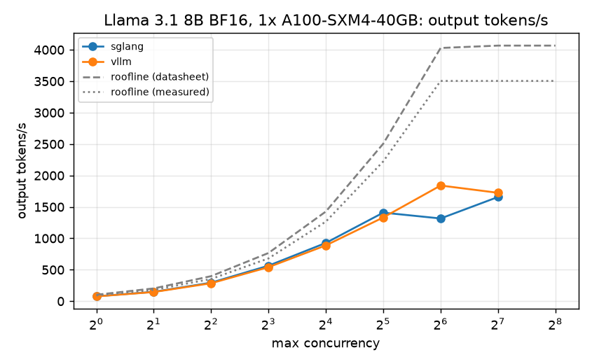
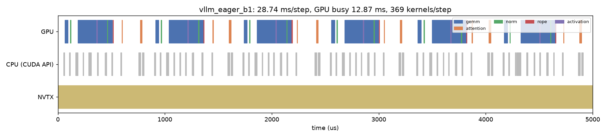
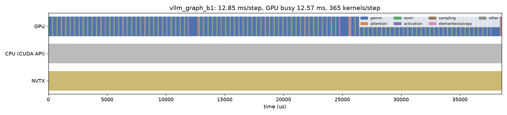
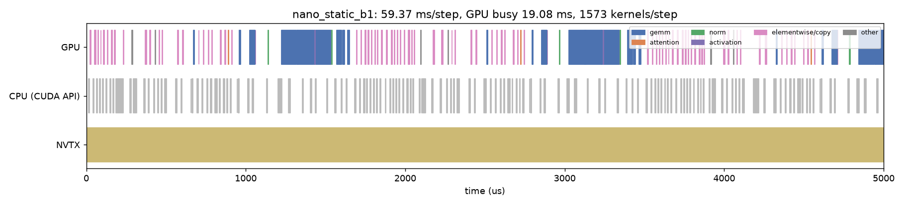
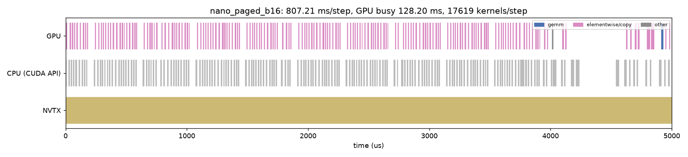

# Phase 0: baseline and roofline

Baseline for Llama 3.1 8B Instruct (BF16) on one A100, with vLLM and SGLang as the reference engines and our own nano_vllm as the starting point. Every number is compared with the roofline bound, and every later optimization is scored by how far it is from that bound. The roadmap is [Inference Engine optimization roadmap](https://claude.ai/artifact/Goa72xjG2zaX8Lw411ueiU); the runs, failures and fixes are recorded in [LOG.md](LOG.md).

- **Run**: `results/20261022-colab-a100-40gb/`, 2026-10-22.
- **Hardware**: Google Colab A100-SXM4-40GB (driver 580, 1,555 GB/s, BF16 312 TFLOPs).
- **Software**: vLLM 0.19.1 (torch 2.10), SGLang 0.5.22 (torch 2.14, flashinfer 0.7.1), nsys / ncu 2025.3.

## Key findings

1. **At batch=1, vLLM and SGLang are already at the cuBLAS floor.**
   - vLLM takes 12.62 ms per decode step; the GPU runs kernels 98% of the time, 91% of it GEMV.
   - The cuBLAS linear layers alone (M=1) add up to 12.49 ms, so vLLM is only 0.13 ms above this floor.
   - The remaining headroom is in the GEMVs themselves: cuBLAS reaches only 63% of bandwidth on o_proj and 73% on qkv. If every GEMV ran at copy bandwidth (1,380 GB/s), a step would take 10.9 ms, 14% faster.
   - Going faster than that requires reading fewer bytes, for example W4A16.
2. **CUDA graphs save 10 ms per token.**
   - vLLM in eager mode takes 22.7 ms per step: the GPU is busy for 12.9 ms, and the other 15.9 ms are spent waiting on 369 kernel launches.
   - With CUDA graphs, a step has only 15 launches.
3. **nano_vllm starts 3.5× slower than vLLM, and worse when batching.**
   - static b=1: 44.1 ms per token. Each step launches 1,573 kernels; the GPU works for only 19 ms and waits on the CPU for 40 ms.
   - paged b=16 (input 1024): 619 ms per step, only 26 tok/s. Each step has 17,619 kernels, and 70% of kernel time is elementwise and copy, i.e. moving KV one sequence at a time.
4. **At larger batches, attention matters.**
   - In vLLM at b=64 and ctx about 1,060, attention (FA2 split-KV) takes 30% of GPU time. Estimated from KV bytes, it runs at about 1.3 TB/s (84% of peak).
   - This is the reference for the Phase 1 paged decode attention kernel.
5. **Throughput** (input 1024 / output 256):
   - vLLM peaks at c=64 with 1,840 tok/s; SGLang peaks at c=32 with 1,409 tok/s.
   - SGLang drops to 1,316 tok/s at c=64, and TPOT jumps from 18.5 ms to 40 ms. The likely cause is that its default decode CUDA graphs are captured only up to batch 32; this is not verified.
   - After the weights, the 40GB card fits only about 140k tokens of KV cache, so at c=128 both engines start queueing.

## Roofline

A decode step reads all the weights from HBM once. The roadmap originally used the full 16.06 GB of weights, but the embedding table reads only one row per token while lm_head is read in full, so the bytes actually read are **15.01 GB**:

$$t_{\text{token}} \geq \frac{15.01\ \text{GB}}{\text{HBM bandwidth}}$$

Each token also reads 128 KiB of KV cache (2 × 32 layers × 8 KV heads × 128 × 2 bytes). `roofline.py` computes bytes and FLOPs from the model shapes and takes max(memory time, compute time).

| GPU | bandwidth | batch=1 floor | ceiling |
|---|---:|---:|---:|
| A100 80GB (datasheet) | 2,039 GB/s | 7.38 ms | 136 tok/s |
| A100 40GB (datasheet) | 1,555 GB/s | 9.67 ms | 103 tok/s |
| A100 40GB (this card, measured 1 GiB copy) | 1,380 GB/s | 10.90 ms | 92 tok/s |

The full batch-versus-roofline table is in [roofline.md](results/20261022-colab-a100-40gb/roofline.md).

## Batch=1 decode

| measurement | ms/token | tok/s | % of roofline |
|---|---:|---:|---:|
| roofline (datasheet) | 9.67 | 103 | 100% |
| roofline (measured copy bandwidth) | 10.90 | 92 | 89% |
| cuBLAS linear layers summed (M=1, no attention) | 12.49 | 80 | 77% |
| SGLang serve, TPOT p50 (input 128 / output 256) | 12.61 | 79 | 77% |
| vLLM engine step (CUDA graph) | 12.62 | 79 | 77% |
| vLLM serve, TPOT p50 (input 128 / output 256) | 12.97 | 77 | 75% |
| vLLM engine step (eager) | 22.68 | 44 | 43% |
| nano_vllm static path | 44.10 | 23 | 22% |
| nano_vllm paged engine | 53.63 | 19 | 18% |

### cuBLAS GEMV bandwidth (`bandwidth.py`, M=1)

| layer | shape (out × in) | weights | time | effective bandwidth | % of peak |
|---|---|---:|---:|---:|---:|
| qkv_proj | 6144 × 4096 | 50 MB | 44.1 µs | 1,142 GB/s | 73% |
| o_proj | 4096 × 4096 | 34 MB | 34.4 µs | 976 GB/s | 63% |
| gate_up_proj | 28672 × 4096 | 235 MB | 182.1 µs | 1,290 GB/s | 83% |
| down_proj | 4096 × 14336 | 117 MB | 107.1 µs | 1,096 GB/s | 70% |
| lm_head | 128256 × 4096 | 1,051 MB | 726.5 µs | 1,446 GB/s | 93% |

The smaller the matrix, the harder it is for cuBLAS to saturate bandwidth. Up to M=16 the linear layers' total time stays at 12.2–12.6 ms; M=64 is 15.5 ms and M=256 is 20.1 ms. At M=4096 the GEMMs reach 247–269 TFLOPs, 79–86% of peak.

## Throughput sweep

Client is `vllm bench serve` with the random dataset, input 1024 / output 256 and `--ignore-eos`; every point was checked for `completed` and `total_output_tokens` matching the expected values.

| engine | concurrency | output tok/s | TTFT p50 (ms) | TPOT p50 (ms) | ITL p99 (ms) |
|---|---:|---:|---:|---:|---:|
| vLLM | 1 | 76 | 26 | 13.1 | 13.3 |
| vLLM | 8 | 542 | 75 | 14.5 | 15.9 |
| vLLM | 32 | 1,332 | 234 | 21.4 | 136.4 |
| vLLM | 64 | **1,840** | 606 | 27.3 | 151.8 |
| vLLM | 128 | 1,725 | 737 | 71.5 | 186.2 |
| SGLang | 1 | 78 | 53 | 12.7 | 12.9 |
| SGLang | 8 | 565 | 85 | 13.9 | 14.5 |
| SGLang | 32 | **1,409** | 172 | 18.5 | 19.4 |
| SGLang | 64 | 1,316 | 1,994 | 40.0 | 38.7 |
| SGLang | 128 | 1,658 | 4,398 | 48.4 | 42.8 |

- **ITL**: at c≥16 vLLM's p99 ITL jumps to 64–186 ms, while SGLang stays below 43 ms. This is prefill interrupting decode, from their different chunked prefill policies. Phase 2 measures exactly this.
- **TTFT**: at c=1 SGLang's TTFT (about 50 ms) is twice vLLM's (22–26 ms).
- **Startup time**: the vLLM server is ready in 86 s; SGLang in 152 s, including flashinfer's JIT compilation.

The full tables (with p99 and total throughput) are in [summary.md](results/20261022-colab-a100-40gb/summary.md), and the plots in [plots/](results/20261022-colab-a100-40gb/plots/):



## Where a decode step's time goes (nsys)

`vllm_offline.py` and `nano_bench.py` drive the engine steps themselves, wrap each step in an NVTX range, and record only the decode steps after prefill. The numbers are medians over 64 steps.

| capture | batch | ms/step | GPU busy | GPU idle | kernels/step | launches/step | kernel time breakdown |
|---|---:|---:|---:|---:|---:|---:|---|
| vLLM CUDA graph | 1 | 12.85 | 12.57 | 0.28 | 365 | 15 | GEMM 91%, attention 5% |
| vLLM eager | 1 | 28.74 | 12.87 | 15.87 | 369 | 369 | GEMM 89%, attention 5% |
| vLLM CUDA graph (ctx ≈1,060) | 64 | 22.69 | 22.62 | 0.07 | 463 | 15 | GEMM 65%, attention 31% |
| nano static | 1 | 59.37 | 19.08 | 40.30 | 1,573 | 1,573 | GEMM 73%, elementwise/copy 22% |
| nano paged | 1 | 69.88 | 19.87 | 50.01 | 1,604 | 1,604 | GEMM 72%, elementwise/copy 24% |
| nano paged (ctx ≈1,060) | 16 | 807.21 | 128.20 | 679.02 | 17,619 | 17,619 | elementwise/copy 70%, GEMM 25% |

nsys itself adds some overhead: vLLM graph b=1 is 12.85 ms under nsys and 12.62 ms without it. Launch-heavy cases like eager and nano are affected more (eager: 28.7 vs 22.7 ms).

| vLLM eager b=1 (5 ms zoom): the gaps between kernels are launches | vLLM CUDA graph b=1 (3 steps): the GPU stays busy |
|---|---|
|  |  |

| nano static b=1 (5 ms zoom) | nano paged b=16 (5 ms zoom) |
|---|---|
|  |  |

## Hardware counters of the decode kernels (ncu)

Only ncu on Colab can read hardware counters, not on RunPod; see "Profiling environment" in the roadmap. This captures one full vLLM b=1 decode step (367 kernels) and the first 300 kernels of nano static b=1 (about 10 layers).

Settings:
- sections: SpeedOfLight, MemoryWorkloadAnalysis, Occupancy, LaunchStats, WarpStateStats.
- `--clock-control none`, so kernels run at the actual boost clock.
- By default ncu flushes caches before each pass, so the sum (13.39 ms) is slightly longer than the 12.57 ms nsys measured.

**vLLM b=1** (kernel time for one step 13.39 ms, average DRAM bandwidth 1,147 GB/s):

| kernel | layer (inferred from count and mean time) | count | time share | DRAM % of peak | achieved occupancy | main stall |
|---|---|---:|---:|---:|---:|---|
| `ampere_bf16_s16816gemm_bf16_64x64_sliced1x2…` | gate_up ×32, lm_head | 33 | 47% | 88% | 12% | long_scoreboard |
| `ampere_bf16_s16816gemm_bf16_64x64_sliced1x2…` | qkv, down | 64 | 31% | 75% | 6% | long_scoreboard |
| `cutlass::Kernel2<…s16816gemm…>` | o_proj | 32 | 11% | 77% | 6% | long_scoreboard |
| `flash_fwd_splitkv_kernel` + `combine` | attention | 64 | 5% | 1–4% | 6–7% | long_scoreboard |
| `triton_red_fused_…rsqrt` (residual + RMSNorm) | norm | 64 | 2% | ≈0 | 24% | long_scoreboard |

The GEMVs have low occupancy (6–12%) and stall on long_scoreboard (waiting for global memory). The cutlass kernel for o_proj moves more DRAM traffic than its weights (34 MB). Its effective bandwidth counted on weight bytes is only about 760 GB/s; the extra is probably split-K workspace reads and writes.

**nano static b=1**: the two largest GEMVs reach 1,175–1,232 GB/s, close to vLLM. But each layer runs about 25 extra PyTorch elementwise, index and cat kernels (RoPE, repeat_kv, KV cache reads and writes), each only 3–8 µs with almost no DRAM use. The time is all wasted on launches.

The full per-kernel tables are in [summary.md](results/20261022-colab-a100-40gb/summary.md). The raw reports `ncu/*.ncu-rep` are 80–130 MB and not in git.

## What this means for Phases 1–2

Ordered by impact:

1. **A paged decode attention kernel for nano** (Phase 1, first item): at b=16, 70% of kernel time goes to moving KV one sequence at a time, and the GPU is busy only 16% of the time. The reference is vLLM's FA2 split-KV, at about 1.3 TB/s at b=64.
2. **Fused kernels plus CUDA graphs for nano** (Phase 1 fusion + Phase 2):
   - 1,573 → 300–400 kernels per step, then CUDA graphs to cut launches from 1,573 per step to single digits.
   - The goal is to go from 44 ms to vLLM's 12.6 ms.
   - The vLLM eager vs graph pair (22.7 → 12.6 ms) already shows what this step is worth.
3. **A bf16 GEMV that beats cuBLAS** (Phase 1, advanced): the o_proj and qkv shapes get only 63–73% of bandwidth. The target is ≥85%, which would bring batch=1 from 12.5 ms to about 11 ms.
4. **W4A16 GEMV**: the linear layers read a quarter of the bytes, so the theoretical batch=1 floor drops from 9.7 ms to about 2.4–2.9 ms (depending on whether lm_head is quantized too). This is the biggest lever for batch=1 latency.
5. **To verify**: whether SGLang's drop at c=64 comes from the decode CUDA graphs' `max_bs=32`. Rerunning once with a larger `--cuda-graph-max-bs` would confirm it. If the default is a poor choice on a 40GB A100, it might make an upstream issue or PR.

## Reproducing

```bash
bash benchmarks/phase0/colab_phase0.sh
```

This starts a Colab A100, uploads the code, runs every step, downloads the results to `results/<run_id>/` and shuts the VM down. The whole run takes about 1 hour.

```bash
P0_RUN_ID=<run_id> P0_STEPS="ncu summarize" COLAB_KEEP=1 bash benchmarks/phase0/colab_phase0.sh rerun
```

Reruns only some steps on the same VM. The venv and model are kept; nsys and ncu labels that were already analyzed are skipped automatically.

```bash
python benchmarks/phase0/roofline.py --gpu A100-SXM4-40GB --bandwidth-json benchmarks/phase0/results/<run_id>/bandwidth.json
```

Recomputes the roofline locally.

```bash
python benchmarks/phase0/summarize.py benchmarks/phase0/results/<run_id>
```

Regenerates summary.md and the plots locally; needs matplotlib.

`run_phase0.sh` itself is not tied to a platform and can run directly as a pod's start command on 80GB machines such as RunPod. With `P0_REPO` set, each step uploads its results to a private HF dataset repo when it finishes; ncu does not work on RunPod, though.

```bash
BENCH_PHASE=phase1 bash benchmarks/phase0/colab_phase0.sh
```

The same Colab driver also runs Phase 1: with `BENCH_PHASE=phase1` it runs `benchmarks/phase1/run_phase1.sh` instead and downloads the results to `benchmarks/phase1/results/`; details in the [Phase 1 README](../phase1/README.md). The step runner, install functions and nsys and ncu functions shared by both phases are in `lib.sh`.

## Files

| file | contents |
|---|---|
| `run_phase0.sh` | main flow: install, benchmark, nsys, ncu, summarize. Each step writes its own log and is recorded in `status.tsv`; a failed step does not affect the steps after it |
| `colab_phase0.sh`, `colab_launcher.py` | drive Colab from the local machine: upload, run, stream logs, download |
| `roofline.py`, `bandwidth.py` | bound calculation; measured copy bandwidth and cuBLAS times at each M |
| `vllm_offline.py`, `nano_bench.py` | drive the engine steps directly for timing, profiling only decode steps |
| `analyze_nsys.py`, `analyze_ncu.py`, `summarize.py` | turn SQLite and raw CSV into JSON, tables and plots |
| `results/<run_id>/` | `summary.md`, `serve/` (JSON for each sweep point), `nsys/`, `ncu/`, `offline/`, `logs/`, `environment.txt`, `status.tsv`, and a copy of the run's code in `code/` |

## Limitations

- **Hardware**: this was an A100 40GB, not the 80GB the roadmap originally assumed. The 80GB card has 2,039 GB/s of bandwidth and twice the KV cache, so absolute numbers will differ; the percentages of roofline compare more directly.
- **Repetitions**: each configuration ran once, with no repeated measurements and no variance. The c=1 TPOT differs by only 1% between the latency and sweep measurements, so the noise looks small.
- **Model**: `unsloth/Meta-Llama-3.1-8B-Instruct`, whose weights are identical to the official meta-llama release but need no token.
- **Workload**: random token prompts, greedy decode, `ignore_eos`. Prefix cache hits, realistic length distributions and Poisson arrivals were not tested.
- **SGLang**: no nsys capture, because it is a multi-process server.
- **nano_vllm bug**: its `silu_mul` Triton kernel originally did not compile for bf16. This is Phase 0's only code change to the repo; see LOG.md.
